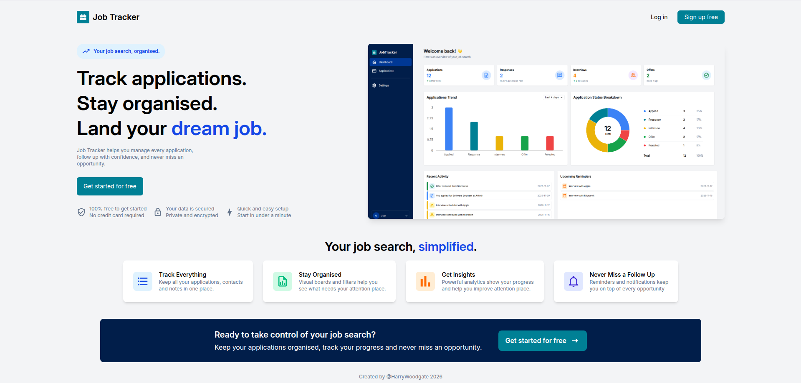
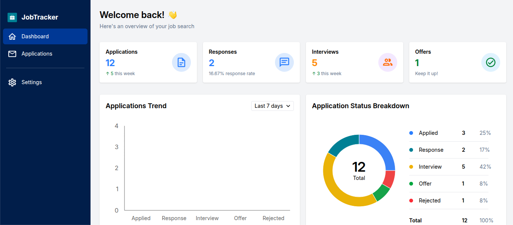
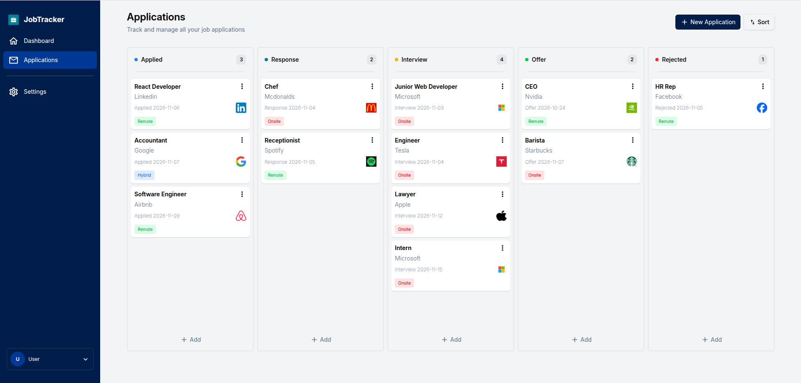
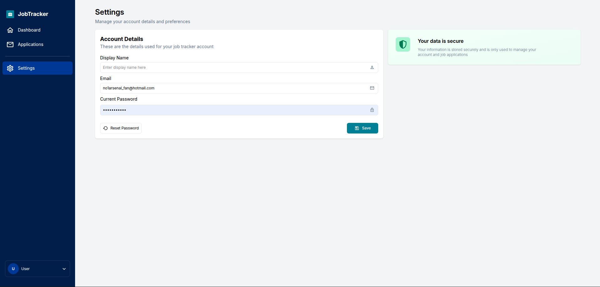

# Job Tracker

https://hwjobtracker.netlify.app/

Job Tracker is an App designed to help users keep track of their job applications. Users can create a record of their applications and cycle them through different stages starting from applied, to response, interview, offer and rejection. Each application has a date attached to each stage so users can easily keep track of their progression and can even specify what type of job it is, whether on site, remote or a hybrid of both. The app also provides visual representation of the data so that users can see how their job search is progressing over time.

## Contents

- [Features](#features)
- [Screenshots](#screenshots)
- [Technologies Used](#technologies-used)
- [Getting Started](#getting-started)
- [Environment Variables](#environment-variables)
- [Database Structure](#database-structure)
- [Testing](#testing)
- [License](#license)

## Features

**Application Management**

- Create, edit and delete applications
- Track applications through different recruitment stages
- Sort applications by date

**Dashboard and Analytics**

- Application statistics and records
- Visual representation of applications over time
- Recent activity
- Upcoming reminders

**User Accounts and Settings**

- Secure user authentication
- Sign in with google
- Personalise display name

**Additional Functionality**

- Automatically fetch company logos
- Drag and drop applications between stages
- Responsive layout for desktop and mobile devices

## Screenshots






## Technologies Used

**Frontend**

- React(vite)
- Typescript
- Tailwind CSS
- React router
- Recharts
- Logo.dev (company logo API)
- Tanstack query

**Backend**

- Supabase

**Testing**

- Vitest
- React Testing Library

## Getting Started

- Clone the github repo from https://github.com/harrywoodgate/job_tracker
- Install the dependencies with your preferred package manager:

### npm

```bash
npm install
```

### yarn

```bash
yarn install
```

### pnpm

```bash
pnpm install
```

- Add environment variables (see below)
- Run the dev server:

### npm

```bash
npm run dev
```

### yarn

```bash
yarn dev
```

### pnpm

```bash
pnpm dev
```

## Environment Variables

Create a `.env.local` file in the project root and add:

VITE_SUPABASE_URL=your_supabase_url  
VITE_SUPABASE_ANON_KEY=your_supabase_anon_key

You must create your own Supabase project and supply your own keys.

## Database Structure

The supabase database structure will require the following tables:

### job_applications

To store information about each application added by the user including the job title, company name, current status and date records.

RLS Policies:

- Users can delete their own logs
- Users can insert and read their own logs
- Users can update their own logs

### auth.users

Stores authenticated user accounts and profile customisations.

All database and storage operations require a valid supabase session controlled by:

- `supabase.auth.signInWithPassword()`
- `supabase.auth.onAuthStateChange()`
- `supabase.auth.getSession()`

## Testing

This project uses Vitest and React Testing Library and covers any user interaction with the app. Run the test using the test script:

### npm

```bash
npm test
```

### yarn

```bash
yarn test
```

### pnpm

```bash
pnpm test
```
